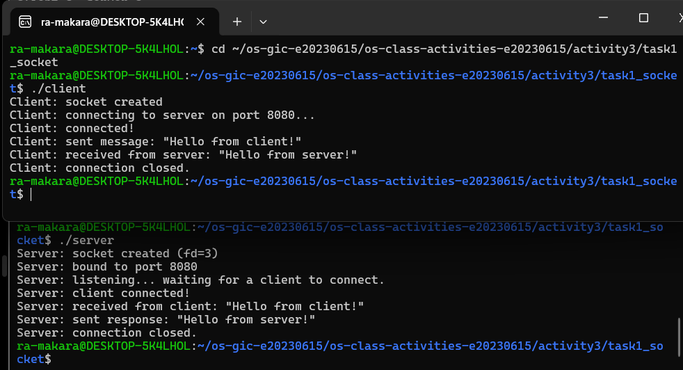
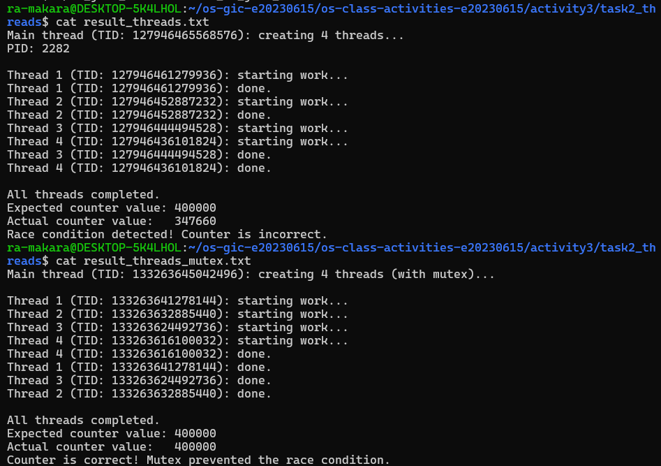
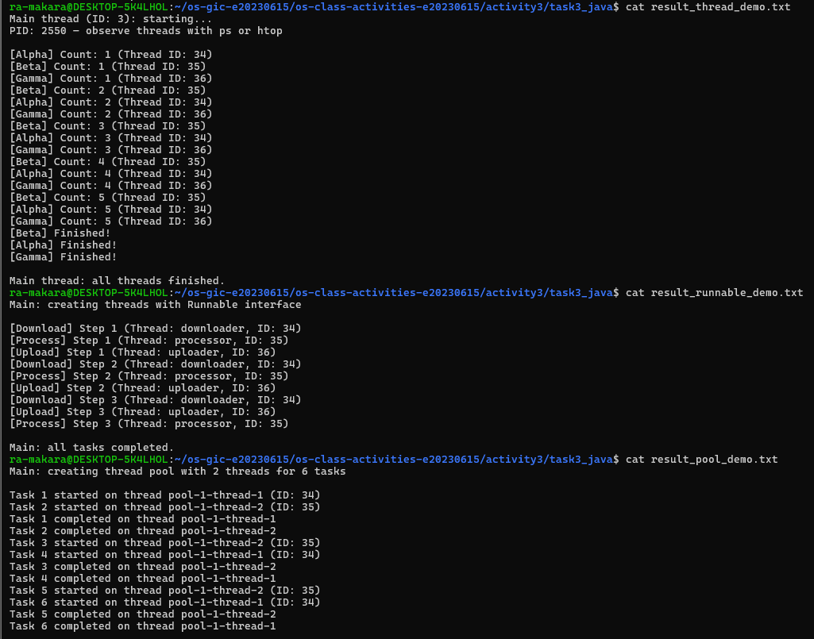
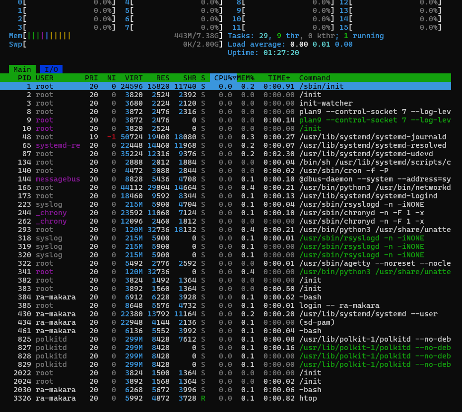
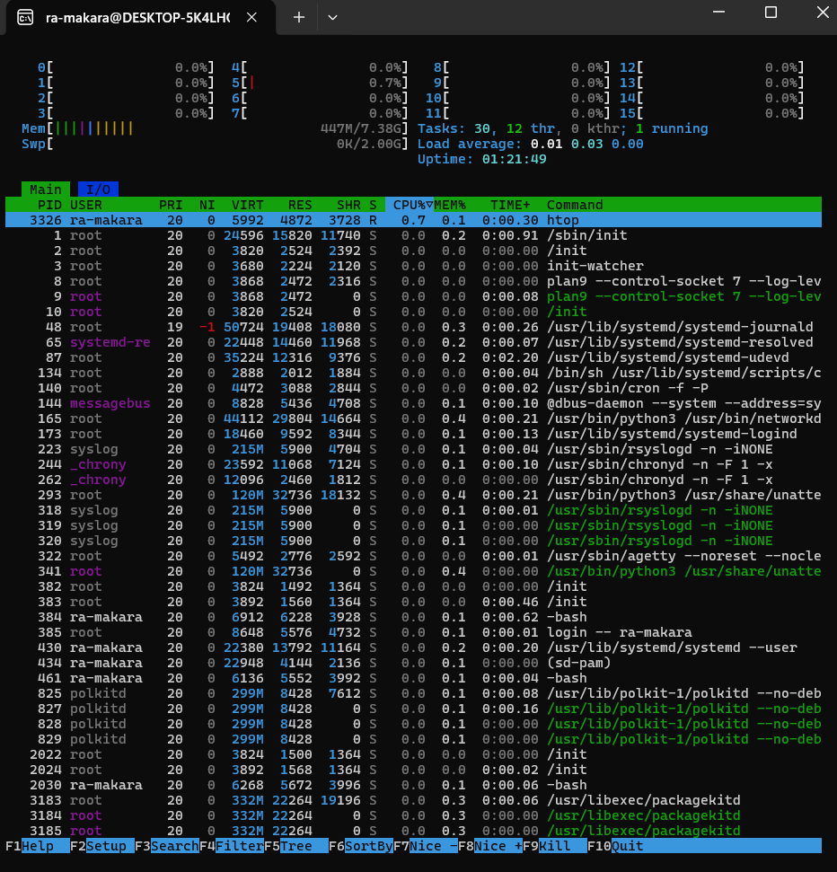
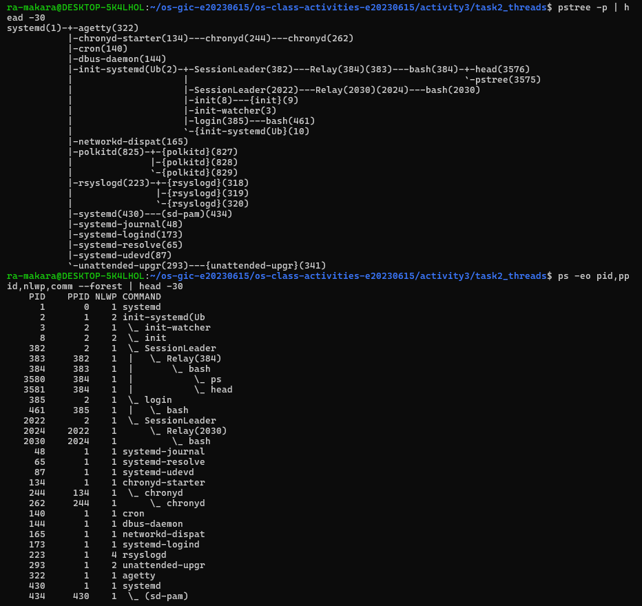
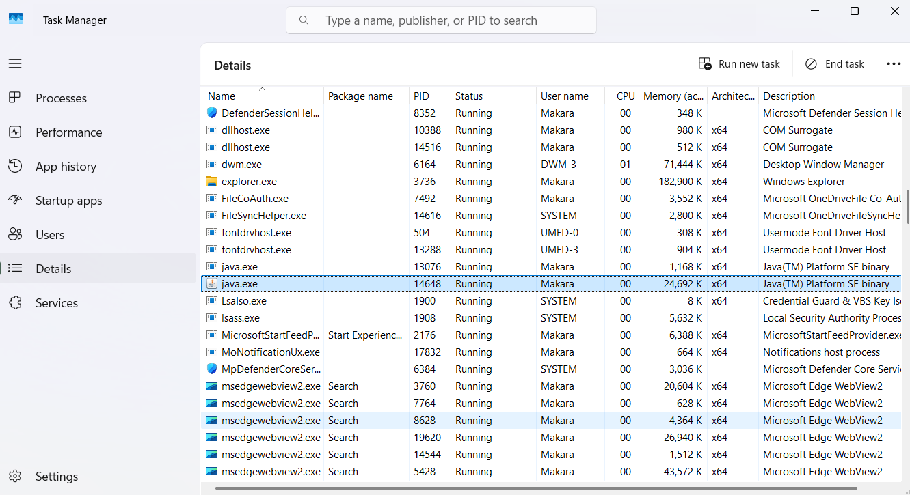

# Operating Systems – Class Activity 3

**Student Name: Ra Makara**
**Student ID:** e20230615
**Date:** 18 November 2026

---

# Task 1 – TCP Socket Communication

## 1. Objective

To implement TCP client-server communication using C on Linux. The server listens on port 8080, accepts a client connection, receives a message, and sends a response.

## 2. Programs

- `server.c` – Creates and manages the TCP server.
- `client.c` – Connects to the server and exchanges messages.

## 3. Results

The client successfully sent a message to the server, and the server returned a response.

**Screenshot:**



## 4. Questions and Answers

**Q1. What is the purpose of `bind()`? Why doesn't the client usually need it?**

`bind()` assigns a local IP address and port number to a socket. A server needs it to specify the port where clients can connect. A client usually does not need it because the operating system automatically assigns an available temporary port.

**Q2. What does `accept()` return? Why does the server keep the original socket open?**

`accept()` returns a new socket file descriptor for communicating with a connected client. The original listening socket remains open so the server can accept additional client connections.

**Q3. What happens if the client runs before the server?**

The client normally receives a `Connection refused` error because no server is listening on the specified port.

**Q4. What is the purpose of `htons()`?**

`htons()` converts a 16-bit number from host byte order to network byte order (big-endian). It is commonly used when specifying a port number in a socket address.

**Q5. Draw the sequence of system calls.**

```text
SERVER                         CLIENT
  |                               |
socket()                       socket()
  |                               |
bind()                            |
  |                               |
listen()                          |
  |                          connect()
accept() <------------------------|
  |                               |
read()/recv() <---------------- send()
  |                               |
send() -----------------------> read()/recv()
  |                               |
close(client_fd)               close()
  |
close(server_fd)
```

---

# Task 2 – POSIX Threads in C

## 1. Objective

To understand multithreading in C using POSIX threads (`pthread`). The activity demonstrates shared data, race conditions, and mutex synchronization.

## 2. Programs

- `threads.c` – Demonstrates multiple threads accessing a shared counter without a mutex.
- `threads_mutex.c` – Uses a mutex to protect the shared counter.
- `threads_observe.c` – Creates multiple threads for OS-level observation in Task 4.

## 3. Results

Without a mutex, multiple threads access and modify the shared counter without synchronization. The final result may be incorrect because of a race condition.

With a mutex, only one thread can access the protected critical section at a time. The final counter should be 400000.

**Screenshot:**



## 4. Questions and Answers

**Q1. What is a race condition?**

A race condition occurs when multiple threads access and modify shared data concurrently without proper synchronization. This can cause unpredictable results or lost updates.

**Q2. How does `pthread_mutex_lock()` prevent race conditions?**

`pthread_mutex_lock()` allows only one thread at a time to enter a protected critical section. Other threads must wait until the mutex is unlocked.

**Q3. What happens if `pthread_join()` is not used?**

Without `pthread_join()`, the main thread does not wait for the worker threads to finish. If the main function returns, the process may terminate before the worker threads complete their tasks.

**Q4. What is the difference between a process and a thread?**

A process is an independent running program with its own address space and resources. Threads are execution units within a process. Threads share the process's code, data, and heap, but each thread has its own stack, registers, and program counter.

---

# Task 3 – Java Multithreading

## 1. Objective

To understand Java multithreading using the `Thread` class, the `Runnable` interface, and the `ExecutorService` framework.

## 2. Programs

- `ThreadDemo.java` – Creates threads by extending the `Thread` class.
- `RunnableDemo.java` – Creates threads using the `Runnable` interface.
- `PoolDemo.java` – Uses a fixed thread pool with two worker threads.

## 3. Results

All three Java programs executed successfully. The examples demonstrate concurrent execution, task separation, and thread pool management.

**Screenshot:**



## 4. Questions and Answers

**Q1. What is the difference between extending `Thread` and implementing `Runnable`?**

Extending `Thread` means creating a subclass of the Thread class and overriding its `run()` method. Implementing `Runnable` separates the task from the thread that executes it. `Runnable` is generally more flexible because Java allows a class to extend only one class.

**Q2. What does `newFixedThreadPool(2)` mean?**

It creates a thread pool with a maximum of two worker threads running tasks simultaneously. Additional tasks wait in a queue until a worker becomes available.

**Q3. Why is `join()` important?**

`join()` makes the calling thread wait until another thread finishes execution. Without it, the main thread may continue before the worker threads have completed their tasks.

**Q4. What is the advantage of `ExecutorService` over manually creating threads?**

`ExecutorService` manages thread creation, task execution, and thread reuse. It also supports task queues, controls the number of concurrent threads, and provides methods for shutting down the executor properly.

---

# Task 4 – Observing Threads at the OS Level

## 1. Objective

To observe threads at the operating system level using Linux commands, `htop`, the `/proc` filesystem, and Windows Task Manager.

## 2. Linux Thread Observation



The `threads_observe` program creates four worker threads and keeps them sleeping temporarily so they can be observed.

### Commands Used

```bash
ps -eLf | grep '[t]hreads_observe'
ps -T -p <PID>
ls /proc/<PID>/task/
ls /proc/<PID>/task/ | wc -l
grep -E 'Name|State|Threads' /proc/<PID>/status

```

The process has five threads in total: one main thread and four worker threads.

### htop – User Threads

The `htop` utility was used to observe the running process and its threads.




### htop – Kernel Threads

Kernel threads were inspected using `htop` and its tree view. The `kthreadd` process is the parent of Linux kernel threads.


### Terminal – Kernel Thread Observation




The following commands were used to inspect process and kernel thread information:

```bash
ps -L -o pid,lwp,nlwp,psr,stat,comm -p <PID>
ps -o pid,ppid,psr,comm -p 2
ps --ppid 2 -o pid,ppid,psr,comm | head -15
pstree -p | head -30
ps -eo pid,ppid,nlwp,comm --forest | head -30
```




## 3. Windows Thread Observation

The Java program was executed on Windows with a longer sleep duration so that its running process could be inspected.

Windows Task Manager was opened using `Ctrl + Shift + Esc`. In the Details tab, the Threads column was enabled to observe the Java process.


## 4. Questions and Answers

**Q1. What is the difference between a process and a thread in Linux?**

A process is an independent execution environment with its own virtual address space. A thread is an execution unit within a process. Threads share process resources but have separate execution states, stacks, and thread IDs.

**Q2. What does `/proc/<PID>/task/` contain?**

It contains information about all threads belonging to a particular process. Each thread is represented by a directory named after its thread ID (TID).

**Q3. What is `kthreadd`?**

`kthreadd` is the Linux kernel thread manager. It runs as PID 2 and is responsible for creating and managing other kernel threads.

**Q4. What is the purpose of `htop`?**

`htop` is an interactive process-monitoring tool that displays running processes, CPU usage, memory usage, and thread information.

**Q5. How can we observe threads in Windows?**

We can use Windows Task Manager. In the Details tab, enable the Threads column to see the number of threads used by each process.

**Q6. Why are threads important in modern operating systems?**

Threads allow multiple tasks to execute concurrently within a process. They improve responsiveness, resource sharing, and CPU utilization, especially on multicore processors.

---

# Reflection

Through this activity, I learned how processes and threads work in operating systems. I practiced TCP socket communication, POSIX thread programming, synchronization using mutexes, and Java multithreading.

I also learned how to observe running threads using Linux commands, the `/proc` filesystem, `htop`, and Windows Task Manager. These exercises helped me understand the relationship between programming concepts and operating system behavior.

---

# Submission Structure

```text
activity3/
├── README.md
├── screenshots/
│   ├── task1_socket_exchange.png
│   ├── task2_threads_output.png
│   ├── task3_java_output.png
│   ├── task4_htop_threads.png
│   ├── task4_htop_kernel_threads.png
│   ├── task4_kernel_threads.png
│   └── task4_taskmanager_threads.png
├── task1_socket/
├── task2_threads/
└── task3_java/
```

