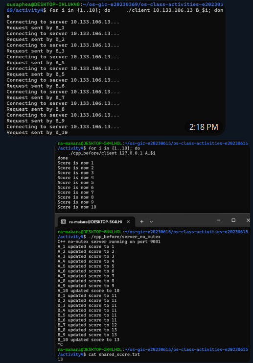
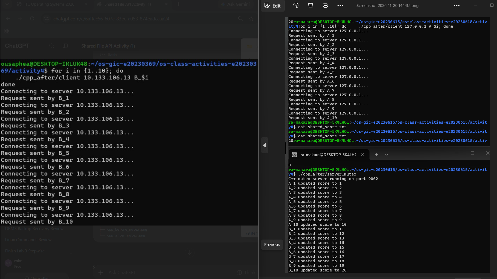
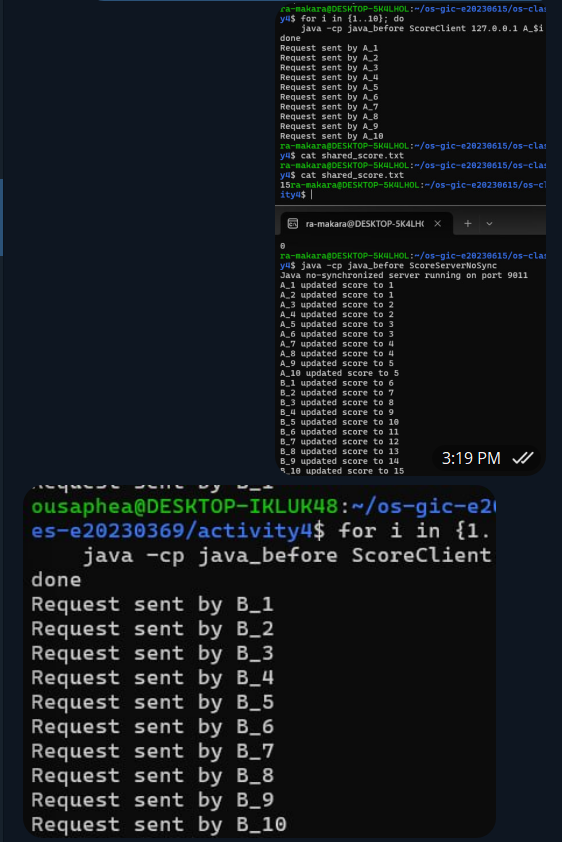
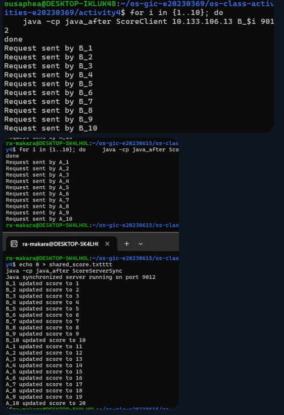

# Class Activity 4 — Shared File API

- **Student Name:** Ra Makara
- **Student ID:** e20230615
- **Partner Name:** Sun Ousaphea
- **Partner Student ID:** e20230369
- **Server Machine Owner:** Ra Makara
- **Server IP Address:** `10.133.106.13`

---

## Task 1: C++ Before Mutex

- Expected score after 20 total client requests: 20
- Actual score: 13
- What happened: The server handled multiple client requests using separate threads without synchronization. Some threads read the same old score and overwrote each other's updates. This caused lost updates, so the final score was 13 instead of 20.

---

## Task 2: C++ After Mutex

- Expected score after 20 total client requests: 20
- Actual score: 20
- What changed after adding mutex: We added `std::mutex` and `std::lock_guard<std::mutex>` to protect the complete read-modify-write operation. Only one thread can update the shared score at a time, preventing lost updates.

---

## Task 3: Java Before Synchronized

- Expected score after 20 total client requests: 20
- Actual score: 13
- What happened: The server handled multiple client requests using separate threads without synchronization. Multiple threads could read and update the score at the same time, potentially causing lost updates.

---

## Task 4: Java After Synchronized

- Expected score after 20 total client requests: 20
- Actual score: 20
- What changed after adding synchronized: We added the `synchronized` keyword to the `updateScore()` method. This ensures that only one thread at a time can execute the score update method, preventing multiple threads from overwriting each other's updates.

---

## Questions

**1. Why should clients send requests to the server instead of writing the file directly?**

Clients send requests to the server because the server controls access to the shared file. It provides one central place to manage updates and helps prevent clients from modifying the file independently and causing conflicts.

**2. Why does the server still have a race condition before mutex or synchronized?**

The server uses multiple threads to handle client requests. Without synchronization, two threads can read the same score at nearly the same time, increase it separately, and overwrite each other's results. This causes lost updates.

**3. In the C++ fixed version, what does `std::lock_guard<std::mutex>` protect?**

It protects the critical section containing the complete read-modify-write operation. Only one thread can execute that protected section at a time. The lock is automatically released when the `lock_guard` goes out of scope.

**4. In the Java fixed version, what does `synchronized` protect?**

The `synchronized` keyword protects the `updateScore()` method. Only one thread at a time can execute this static synchronized method on the same Java class, preventing simultaneous updates from interfering with each other.

**5. Why is the final score expected to be 20 when Student A sends 10 requests and Student B sends 10 requests?**

Each successful request increases the score by one. Student A sends 10 requests and Student B sends 10 requests, giving 20 requests in total. Starting from zero, the expected final score is 20 when every update is processed correctly.

**6. What could happen if two separate servers update the same file at the same time?**

Even if each server uses its own mutex or synchronized method, those locks only coordinate threads inside that server process. They do not automatically coordinate with another server process. Both servers could read the same score and overwrite each other's updates. A shared cross-process locking mechanism or centralized update service would be needed.

---

## Reflection

This activity helped us understand why synchronization is important when multiple threads access shared resources.

In C++, we used `std::mutex` with `std::lock_guard` to protect the critical section. In Java, we used the `synchronized` keyword to ensure that only one thread could execute the score update method at a time.

Although the syntax is different, both approaches solve the same problem: preventing race conditions and lost updates.

We learned that protecting shared data is important in concurrent programming. Without synchronization, the result may be incorrect even when every client sends the correct number of requests.
